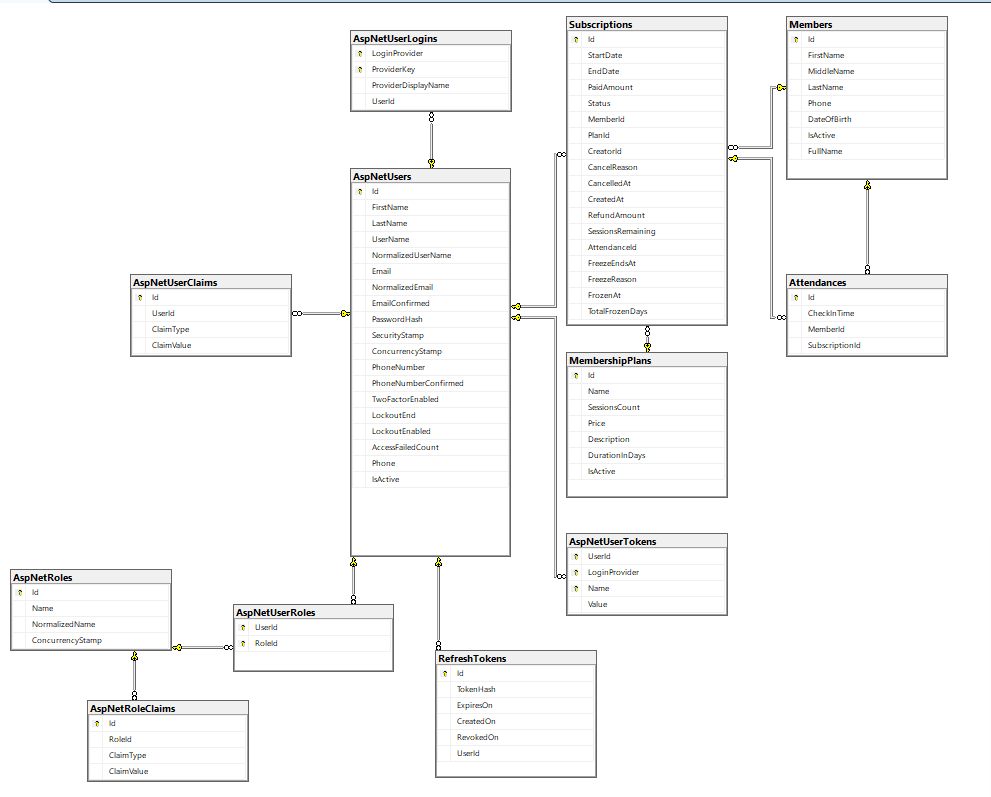
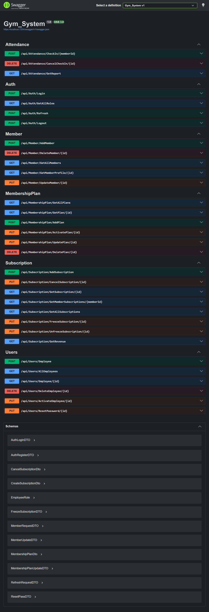

# Gym Management System: REST API

Backend for a gym management system (members, plans, subscriptions, freezing, attendance, reports), built with **ASP.NET Core 9**, **EF Core**, and **SQL Server**, using a layered architecture and role-based permissions.

**Demo:** <https://youtu.be/oqaWRQ7Nmgc?si=OLygq1yflRhzVApv>

- The frontend shown in the demo is an AI-assisted UI used only to demonstrate the API. The backend in this repository is my own implementation.

## Features

- **Members:** Add, edit, and search by name or phone, soft delete with automatic reactivation if the same phone is registered again.
- **Subscription Plans:** Plans by duration, or by number of sessions, or both (sessions = 0 means unlimited), with hiding and reactivation.
- **Subscriptions:** Create, cancel with recording the refunded amount and reason, and renew which automatically cancels the old one. The price is copied at subscription time so editing the plan price does not affect existing ones.
- **Freezing:** Freeze for 7 to 30 days with a total subscription cap, manual or automatic unfreezing upon member attendance, and extending the end date by the actual days.
- **Attendance:** Check active subscription, deduct sessions for limited plans only, prevent duplicates on the same day, near-expiry alerts, and cancel attendance with session refund.
- **Reports:** Attendance report with an optional period (total visits and distinct members across the entire period) and financial report (paid, refunded, net).
- **Employees:** Add, disable, and enable, with revoking tokens of a disabled employee.

## Technologies Used

| Area | Technology |
|---|---|
| Framework | ASP.NET Core 9 Web API (C#) |
| Database | SQL Server + Entity Framework Core 9 (Code First + Migrations) |
| Authentication | ASP.NET Core Identity + JWT Bearer + **Refresh Token Rotation** |
| Authorization | Role-based Authorization (`Admin`, `Receptionist`) |
| Documentation | Swagger / OpenAPI |
| Secrets | .NET User Secrets (Development) |

## Architecture and Patterns

```
Gym_Core            ← Models, DTOs, Interfaces, Services (business logic), Exceptions
Gym_Infrastructure  ← DbContext, Migrations, Repositories, UnitOfWork
Gym_System          ← Controllers, Middleware, Program.cs (the API)

```
### Entity Relationship Diagram (ERD)



- **Layered Architecture** with separation of business logic from the web layer (Core has no dependency on ASP.NET).
- **Generic Repository + Unit of Work** with `GetPagedAsync` and loading relationships via Include.
- **DTO Pattern:** No Entity is sent to the client (preventing Circular References and data leakage).
- **Global Exception Handling Middleware** with custom exceptions (`NotFound`, `Conflict`, `BadRequest`, `Unauthorized`) mapped to appropriate HTTP status codes, and hiding internal error details outside the development environment.
- **Server-side Pagination** with a fixed page size (20) and a response containing `totalCount` and `totalPages`.

## Security

- **Short-lived JWT  + Refresh Token** with a longer lifetime. The Refresh Token is stored as a **SHA-256 Hash** only, and generated with `RandomNumberGenerator`.
- **Rotation:** Each renewal revokes the old token and issues a new one, and reusing a revoked token is rejected.
- **True Logout** by revoking the Refresh Token in the database.
- **Preventing disabled employee login** (Login and Refresh) and revoking their tokens upon disabling.
- `ClockSkew = 0` so the token expires at its exact time.
- **Validation** on DTOs (Data Annotations + Egyptian phone via Regex).
- Secrets outside the code (User Secrets / Environment Variables).

## Important Design Decisions

- **Actual subscription status is calculated at read time** (`GetEffectiveStatus`) instead of a Background Job: expired by date or by sessions, and filtering is translated into SQL conditions so Pagination stays accurate.
- **Soft Delete** for members, plans, and employees to preserve the historical record of subscriptions.
- **Unique Indexes** on member phone and plan name to protect data at the database level.
- `decimal(18,2)` for financial amounts.


## Key Endpoints

| Domain | Examples |
|---|---|
| Auth | `POST /api/Auth/Login` · `Refresh` · `Logout` |
| Members | `GET /api/Member/GetAllMembers?page=&search=` · `POST AddMember` |
| Plans | `GET /api/MembershipPlan/GetAllPlans` · `POST AddPlan` (Admin) |
| Subscriptions | `POST AddSubscription` · `PUT CancelSubscription` · `PUT FreezeSubscription` · `GET GetRevenue` (Admin) |
| Attendance | `POST /api/Attendance/CheckIn/{memberId}` · `GET GetReport` |
| Users | `POST /api/Users/Employee` · `PUT ActivateEmployee` (Admin) |

Full details in Swagger.



